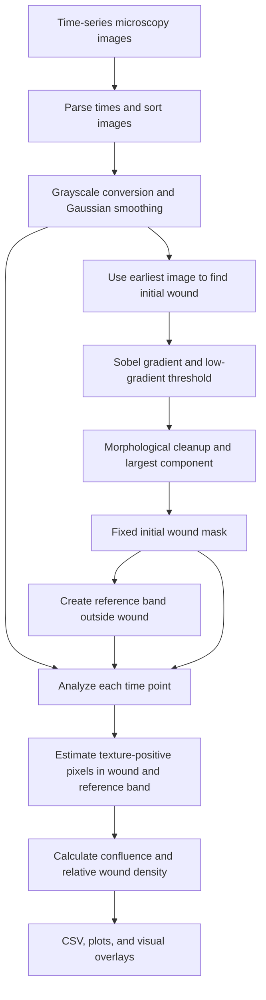

<div align="center">

# InVitroGap

### An open-source, interpretable workflow for scratch-wound image analysis

**Track apparent wound coverage over time from microscopy images using classical computer vision.**

[](LICENSE)
[](https://www.python.org/)
[](https://streamlit.io/)
[](#validation-status-and-limitations)

[Overview](#overview) · [Quick start](#quick-start) · [Methods](#how-it-works) · [Parameters](#analysis-parameters) · [Outputs](#outputs) · [Limitations](#validation-status-and-limitations) · [License](#license)

</div>

---

## Overview

**InVitroGap** is a lightweight Python application for exploratory analysis of *in vitro* cell migration in scratch-wound assays. It processes a time series of microscopy images from **one well or experimental condition at a time** and reports:

- **Wound Confluence (%)** — the proportion of the *initially identified wound region* classified as texture-positive at each time point, used as a proxy for cell coverage.
- **Relative Wound Density (%)** — a baseline-adjusted measure of texture-positive coverage in the initial wound region, normalized using a surrounding reference band.
- **Visual quality-control overlays** — blue denotes the initial wound region; green denotes pixels classified as cell-covered within that region.
- **Time-series plots and a downloadable CSV** of the per-image measurements.

The application uses image-processing rules rather than a trained machine-learning model. Its outputs should be interpreted as **algorithm-derived estimates**, not direct cell counts or independently validated biological ground truth.

## Key features

| Feature | Implementation |
| --- | --- |
| Image inputs | TIFF, PNG, and JPEG files |
| Time ordering | Extracts hours from image filenames |
| Initial wound detection | Gaussian smoothing, Sobel gradients, percentile thresholding, morphological cleanup, largest connected component |
| Reference region | A configurable dilation band outside the initial wound mask |
| Coverage estimation | Adaptive Sobel-gradient threshold derived from the reference band, followed by small-object removal |
| Measurements | Wound Confluence (%) and Relative Wound Density (%) |
| Results | Data table, CSV export, time-series plots, color overlays |
| Interface | Streamlit; an experimental browser-hosted entry point using stlite is also included |

## Quick start

### Requirements

- Python 3 and `pip` (a virtual environment is recommended).
- Image series from the **same field of view**, at the **same pixel dimensions**, magnification, and spatial alignment.

### 1. Clone the repository

```bash
git clone https://github.com/AIProd/caliberatedmigration.git
cd caliberatedmigration
```

### 2. Create and activate a virtual environment

**macOS / Linux**

```bash
python3 -m venv .venv
source .venv/bin/activate
```

**Windows (PowerShell)**

```powershell
py -m venv .venv
.venv\Scripts\Activate.ps1
```

### 3. Install dependencies

```bash
python -m pip install -r requirements.txt
```

### 4. Start the application

```bash
streamlit run app.py
```

Streamlit should display a local address (typically `http://localhost:8501`) where you can open the application.

> **Browser-hosted option:** The repository also contains an `index.html` entry point that loads `app.py` with [stlite](https://github.com/whitphx/stlite). This is a separate, browser-executed deployment path; local Streamlit is the recommended way to run or reproduce an analysis. The availability and compatibility of any public deployment have not been independently verified.

## Using InVitroGap

1. Prepare images for **one experimental well/condition**, captured at successive time points (for example 0, 24, 48, and 72 hours).
2. Include an identifiable time in **each filename**. Supported examples include `RCC_00H.tif`, `RCC_24H.tif`, `RCC_48H.tif`, `RCC_72H.tif`, and `RCC_01d00h00m.tif`.
3. Upload the images together. The application sorts them by parsed time; **the earliest image defines the initial wound region for the entire series**.
4. Inspect the blue initial wound overlay and the green estimated cell-coverage overlay at each time point.
5. If necessary, adjust the analysis parameters and rerun. Record the exact parameter values used.
6. Download the measurement CSV and review both time-series plots.

**Important filename behavior:** The parser recognizes day-and-hour strings such as `01d00h00m`, or hour strings such as `24H` and `72 H`. Filenames with no recognized time default to **0 hours**; verify the inferred sequence before drawing conclusions.

## How it works



### 1. Initial wound segmentation

The first image is converted to grayscale and Gaussian-smoothed. The algorithm computes the Sobel gradient and selects pixels below a configurable gradient percentile as *smooth-region candidates*. It removes small objects, applies morphological closing and opening, and selects the largest connected candidate component as the initial wound mask.

This is a **low-gradient heuristic**, not a general-purpose biological cell/wound segmentation model. Brightness, debris, cell morphology, and imaging conditions can affect the segmentation.

### 2. Reference band

The initial wound mask is dilated to create a ring of pixels **outside** the wound. This surrounding area is used as a reference for adaptive texture thresholding and normalized density calculations.

### 3. Time-point coverage estimation

For each image, Sobel-gradient magnitudes are thresholded at a selected percentile of the values inside the reference band. Pixels exceeding that threshold are considered **texture-positive**. Small disconnected texture-positive components may be removed. The algorithm measures the fraction of texture-positive pixels inside the original wound mask and inside the reference band.

**The original wound mask remains fixed across all time points.** The application does **not** re-segment the open wound boundary independently in each frame or register shifted images automatically.

### 4. Measurements

Let:

- `w(t)` = texture-positive fraction within the initial wound mask at time `t`;
- `w(0)` = that fraction at baseline;
- `c(t)` = texture-positive fraction within the surrounding reference band at time `t`.

**Wound Confluence (%)**

$$
\mathrm{Wound\ Confluence}(t) = 100\, w(t)
$$

**Relative Wound Density (%)**

$$
\mathrm{RWD}(t) = 100\, \frac{w(t)-w(0)}{c(t)-w(0)}
$$

The current code returns `0` when the RWD denominator is nearly zero and clips RWD to the interval `[0, 100]`. Such cases require manual review: clipping or a zero denominator can conceal a noninterpretable calculation.

These measures follow the definitions implemented **in this repository**. Similar metric names used by commercial platforms should not be taken to imply identical image segmentation, cell detection, or measurement performance.

## Analysis parameters

The following are the **current defaults in `app.py`**:

| Parameter in the UI | Default | Interpretation |
| --- | ---: | --- |
| Gaussian blur σ | `1.0` | Smoothing strength before gradient calculation |
| Wound smoothness percentile | `30` | Gradient percentile used to identify smooth wound candidates |
| Wound edge smoothing | `10 px` | Disk radius for morphological closing and opening |
| Minimum wound size | `500 px²` | Minimum candidate-component area before morphological cleanup |
| Reference band thickness | `50 px` | Dilation radius used to form the external reference band |
| Cell texture percentile | `5` | Reference-band gradient percentile used for texture classification |
| Minimum cell object size | `80 px²` | Area cutoff for removing small texture-positive components |

The **Plot scale** and **Overlay columns** controls affect presentation only; they do not change the segmentation or measurement calculations.

> Thresholds and morphology parameters are image- and acquisition-dependent. Defaults were initially tuned for a specific RCC example; they are not universal or independently established as optimal for every dataset. Parameters optimized on a validation dataset should be evaluated again on independent held-out images.

## Outputs

| Output | Description |
| --- | --- |
| On-screen table | `Image`, `Hours`, `Wound Confluence (%)`, `Relative Wound Density (%)` |
| `wound_metrics.csv` | Downloadable copy of the table |
| Wound Confluence vs Time | Line plot across image time points |
| Relative Wound Density vs Time | Line plot across image time points |
| Overlay QC | Original image with the initial wound region in blue and detected texture-positive wound pixels in green |

**Overlay interpretation:** Blue represents the *entire initial wound mask*, including areas that may later become covered. Green indicates pixels classified as cell-covered **inside that fixed mask**; it should not be interpreted as a manually annotated individual-cell mask.

## Suggested image-quality checklist

Before reporting results, verify that:

- [ ] Images are from the same field of view and consistently aligned.
- [ ] Filename-derived hours and the selected baseline are correct.
- [ ] All images have identical dimensions and compatible acquisition settings.
- [ ] The initial wound region is plausible and does not encompass the full image.
- [ ] The outside reference band contains adequate cell-monolayer area.
- [ ] Green overlays correspond plausibly to cell-covered regions rather than artifacts.
- [ ] RWD has no suspicious jumps, saturation at 0%/100%, or unstable denominator effects.
- [ ] Parameter values, source images, and outputs are retained for reproducibility.

## Validation status and limitations

**Research prototype — use with appropriate visual review and experimental validation.**

The present repository provides the interactive analysis code; it does **not** currently include a published, reproducible benchmark suite, precomputed BBBC019 evaluations, paired commercial-platform measurement datasets, or automated regression tests.

Known methodological and implementation limitations include:

1. **Initial wound detection can fail:** selecting the largest low-gradient component may mistake homogeneous background for the wound. In the current implementation, an empty set of foreground components may incorrectly produce a full-image wound mask; this should be fixed before unattended use.
2. **Gradient is a proxy, not cell ground truth:** debris, imaging artifacts, and strong noncellular edges can be classified as cell-covered pixels, while faint cells may be missed.
3. **Fixed geometry requires alignment:** image drift or cropping changes can distort time-series measurements.
4. **Image bit depth:** the current upload path converts images to RGB through Pillow; scientific 16-bit images may lose dynamic-range information.
5. **RWD edge cases:** invalid reference-band or denominator situations are not fully surfaced as errors; RWD is currently clipped to `[0, 100]`.
6. **No automatic multiwell aggregation:** results represent the uploaded image series, not biological replicates or standard errors across wells.

For scientific evaluation, distinguish between **(a) initial wound-mask agreement** against manual ground truth (for example Dice and IoU), **(b) cell-coverage classification**, and **(c) longitudinal metric agreement** with an independently validated measurement method. Strong performance in one does not establish performance in the others.

## Repository structure

```text
caliberatedmigration/
├── app.py            # Image-processing pipeline and Streamlit interface
├── index.html        # Experimental stlite browser entry point
├── requirements.txt  # Python dependencies
├── README.md         # Project documentation (this file)
└── LICENSE           # MIT license
```

## Reproducibility and contributions

For any analysis used in a manuscript, report the repository commit, source image/acquisition details, all seven processing parameters, the image time points, and any excluded images or failed segmentations. If parameters were tuned, describe the optimization data and report independent test-set results separately.

Issues and pull requests are welcome for reproducible bug reports, tests, documentation improvements, and validation datasets (provided you have permission to share the data). When reporting an issue, include a minimal non-sensitive image example, the filename pattern, parameters, expected behavior, and observed behavior.

## License

The project is distributed under the **MIT License**. See [LICENSE](LICENSE) for the full text. Licensing the source code does not by itself establish its scientific validity, and any third-party data or imagery retain their respective rights and restrictions.

---

<div align="center">
  <sub>InVitroGap · Transparent, reproducible scratch-wound image analysis</sub>
</div>
